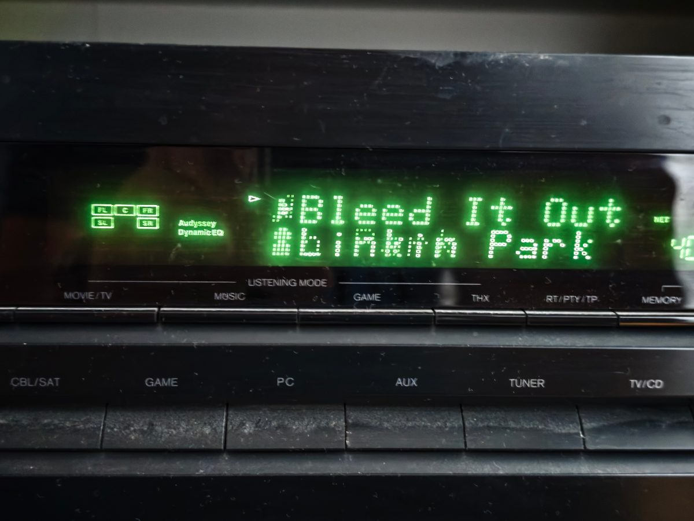
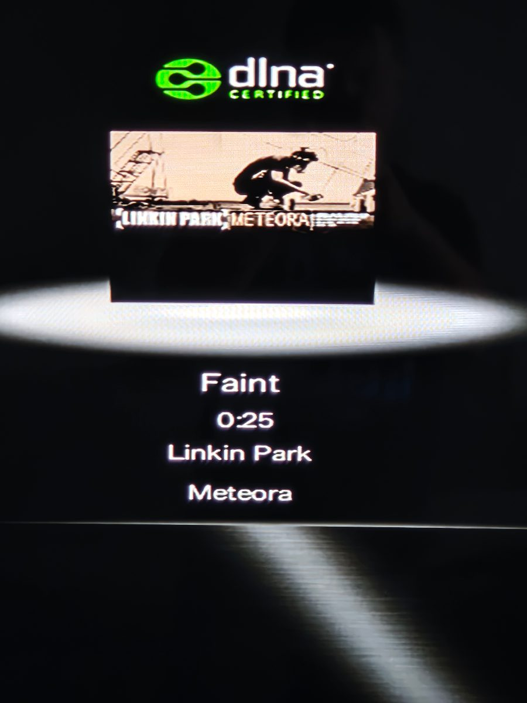

# onkyo-dlna-bridge

**English** | [Polski](README.pl.md)

[](https://github.com/lisek84/onkyo-dlna-bridge/actions/workflows/image.yml)

**Play Spotify on legacy Onkyo network receivers again** (2010–2013 era, e.g. TX-NR609) whose built-in
Spotify feature stopped working when Spotify retired its old libspotify SDK.

A small container on your NAS, Raspberry Pi or Linux box runs **Spotify Soloist** — Spotify's own,
official headless client — and bridges its audio to the receiver's built-in DLNA renderer. In the Spotify
app you pick *"Onkyo Receiver"* from the device list and it plays on your amplifier — with title and artist
on the front display, the album cover on the TV, automatic power-on and input switching, and the remote's
**Stop** / **NET** buttons mapped to pause / resume.

> This is an independent hobby project. It is **not affiliated with, endorsed by or certified by Spotify**
> (the receiver does not become a certified "Spotify Connect" device) **or Onkyo**. Personal, non-commercial
> use only.

## What it looks like

<table>
  <tr>
    <td align="center" width="50%">
      <br>
      <sub><b>Receiver display</b> — track and artist from Spotify, input switched to NET automatically</sub>
    </td>
    <td align="center" width="50%">
      <br>
      <sub><b>TV via the receiver's HDMI on-screen display</b> — album cover, title, elapsed time, artist and album</sub>
    </td>
  </tr>
</table>

Pick the receiver in the Spotify app on your phone — it switches itself on, changes to the NET input and
plays, showing what is playing on its own display and on the TV. Everything else (playlists, search,
skipping) stays in the Spotify app you already use.

No firmware modification, no hacks on the receiver: only its official network interfaces
(UPnP/DLNA and the Onkyo eISCP control protocol) are used.

> **Not only for Onkyo.** The name comes from the receiver it was built for, but the core works with
> practically any **DLNA/UPnP media renderer** that accepts an LPCM stream — other receivers, network
> players, smart TVs, Kodi … The Onkyo-specific extras (power-on, input switching, remote mapping) need an
> Onkyo / Integra (eISCP) device; elsewhere you get playback and, usually, track info.
> See **[docs/compatibility.md](docs/compatibility.md)**.

## Why this project exists

*A personal note from the author.*

My Onkyo TX-NR609 is a perfectly good amplifier. It had Spotify built in — until Spotify retired its old
libspotify SDK and Onkyo simply stopped caring about receivers of that generation. No update, no
replacement, nothing: the Spotify entry in the menu just quietly stopped working and was left there, dead.
Thousands of good devices were downgraded overnight by a decision made somewhere else, and that annoyed me
enough to do something about it.

I wanted a solution that respects both the device and Spotify's rules, so this project deliberately uses
only official building blocks:

- It uses **Spotify Soloist, Spotify's own official client**, with your own developer API key — no
  reverse-engineered Spotify client, no circumvention of anything.
- Soloist is **not redistributed**; each installation downloads it from Spotify's official CDN, as Spotify asks.
- The audio goes **only to your own receiver** in your home network (by default the stream is refused to any
  other device) and is **never recorded or stored**.
- The receiver is driven only through the **interfaces it officially offers** on the network (DLNA renderer
  and Onkyo's eISCP control protocol). Its firmware is not touched.

If you have an old receiver whose streaming features were abandoned the same way, I hope this gives it a
second life too.

## How it works, in short

```
 Spotify app ──Spotify Connect──►  Soloist ─► PulseAudio ─► swyh-rs ─► HTTP proxy ──DLNA/HTTP──► receiver
 (phone/PC)                        └──────────────── container (host network) ──────┘    ▲
                                    receiver control: UPnP AVTransport + eISCP (TCP 60128) ┘
```

Details: [docs/how-it-works.md](docs/how-it-works.md). Technical reference of the receiver for developers: [docs/receiver-internals.md](docs/receiver-internals.md).

## Features

- Appears in the Spotify app's device list via the official **Spotify Soloist** client (no reverse-engineered client)
- Lossless **LPCM 44.1 kHz / 16 bit** stream to the receiver (natively supported by these DMRs)
- **Powers the receiver on** and switches it to NET → DLNA when you start playback
- **Title / artist / album** on the receiver display and **album cover** on the TV (receiver OSD via HDMI), updated on every track change
- Receiver remote: **Stop** pauses Spotify, **NET** resumes, **switching the receiver off** pauses Spotify
- Works around the legacy DMR firmware quirks (UPnP 705 "Transport is locked", Range probing)
- Soloist is downloaded from Spotify's CDN at start and **auto-updated** (builds expire after 90 days)

## Status / tested hardware

| Component | Tested |
|---|---|
| Receiver | **Onkyo TX-NR609** (2011) |
| Host | **Synology DS718+** (x86_64, DSM 7.2, Container Manager) |
| Other x86_64 Linux + Docker / Podman | expected to work (same image) |
| Raspberry Pi / ARM (`Dockerfile.arm`) | **untested** – builds swyh-rs from source |
| Windows (WSL2) | **experimental / untested** – see [docs/windows.md](docs/windows.md) |

Other Onkyo / Integra network receivers of the same generation, and DLNA renderers of other brands,
are expected to work — fully or partially, see [docs/compatibility.md](docs/compatibility.md) — but are
untested. Reports (working or not) are welcome in the
[issues](https://github.com/lisek84/onkyo-dlna-bridge/issues).

## Requirements

- A free **Spotify Soloist API key**, created by a **Spotify Premium** account (once running, Free and Premium
  users can play to it) → [docs/spotify-developer-key.md](docs/spotify-developer-key.md)
- A host in the **same LAN** as the receiver with Docker or Podman, **host networking**, and ~100 MB RAM
  (x86_64, arm64 or armv7; glibc-based image, Debian trixie)
- The receiver with network enabled, a fixed IP, and two settings checked → [docs/receiver-setup.md](docs/receiver-setup.md)
- **Firewall:** the receiver must be able to connect to the host on **TCP 5901** (`STREAM_PORT`), and mDNS
  (UDP 5353) must reach the host → [docs/networking.md](docs/networking.md)

## Quick start (Docker / Podman on Linux)

```bash
git clone https://github.com/lisek84/onkyo-dlna-bridge.git
cd onkyo-dlna-bridge
cp soloist.env.example soloist.env
nano soloist.env            # SOLOIST_API_KEY, RENDERER_IP, DEVICE_NAME, PUID/PGID
docker compose up -d --build   # Raspberry Pi: set dockerfile: Dockerfile.arm in compose.yaml first
docker compose logs -f
```

Open Spotify on your phone → **Devices** → pick your `DEVICE_NAME` → play.
The first connection logs Soloist into your account; afterwards it reconnects on its own.

**Prebuilt image (optional):** the GitHub Actions workflow publishes a multi-arch image (amd64, arm64) to
`ghcr.io/lisek84/onkyo-dlna-bridge`. To use it instead of building locally, replace the `build:` block in
`compose.yaml` with `image: ghcr.io/lisek84/onkyo-dlna-bridge:latest`.

Platform guides:

- **Synology DSM** → [docs/synology.md](docs/synology.md)
- **Linux, Raspberry Pi, Podman / Quadlet** → [docs/linux.md](docs/linux.md)
- **Windows (WSL2)** → [docs/windows.md](docs/windows.md)

## Configuration

All settings live in `soloist.env` (see [soloist.env.example](soloist.env.example) for full comments).

| Variable | Default | Meaning |
|---|---|---|
| `SOLOIST_API_KEY` | – (required) | Your Spotify Soloist API key |
| `RENDERER_IP` | – (required) | IP of the receiver |
| `DEVICE_NAME` | `Onkyo Receiver` | Name in the Spotify app |
| `HOST_IP` | auto | LAN IP of the host (set it if the host has several networks) |
| `PUID` / `PGID` | `1000` / `1000` | Owner of `./config` (Synology: typically `1026` / `100`) |
| `STREAM_PORT` | `5901` | TCP port the receiver pulls audio from — **open it in the firewall** |
| `STREAM_ALLOW` | `renderer` | Who may fetch the stream: `renderer` (only `RENDERER_IP`), a list of IPs/subnets, or empty (anyone in the LAN) |
| `SWYH_PORT` | `5911` | Internal capture port (localhost only) |
| `INITIAL_VOLUME` | `70` | Initial Spotify digital volume |
| `META_UPDATE` | `yes` | Title/artist on the display (2–4 s gap at each track start); `no` = gapless, fixed `PLAY_TITLE` |
| `PLAY_TITLE` | `Spotify` | Display text when no metadata is sent |
| `COVER_ART` | `yes` | Send the album cover (shown on the TV through the receiver's on-screen display) |
| `COVER_SIZE` | `default` | Cover size: `default` (300 px), `large` (640 px), `small` (64 px) |
| `ONKYO_EISCP` | `yes` | Use the Onkyo eISCP protocol; `no` for non-Onkyo renderers |
| `AUTO_POWER_ON` | `yes` | Power the receiver on when playback starts |
| `REMOTE_CONTROL` | `yes` | Remote Stop → pause, NET → resume, power off → pause |
| `NET_RESUME_SECONDS` | `120` | How long after Stop the NET button resumes (NET also opens the NET menu) |
| `VOLUME_SYNC` | `no` | Spotify volume slider ↔ receiver master volume, both ways |
| `VOLUME_MAX` | `50` | Receiver volume at 100 % in Spotify (hard limit) |
| `POWER_ON_VOLUME` | *(empty)* | Receiver volume set only when the container switches it on. **Empty = the receiver starts at its usual volume, as it always did** |
| `RESTORE_INPUT` | `no` | Switch back to the previous input (e.g. TV) when Spotify is done |
| `AUTO_POWER_OFF_MINUTES` | `0` | Standby after N minutes without Spotify, if the container switched the receiver on |
| `IDLE_STOP_SECONDS` | `300` | Stop streaming after this long paused |
| `LOG_TO_FILE` | `yes` | Also log to `config/container.log` |

**Volume options are independent of each other:**

| You want | Settings |
|---|---|
| Leave the receiver's volume alone; the Spotify slider changes only the stream level (default) | `VOLUME_SYNC=no`, `POWER_ON_VOLUME=` |
| Spotify slider controls the receiver, no start-up volume | `VOLUME_SYNC=yes`, `POWER_ON_VOLUME=` |
| Only a fixed start-up volume | `VOLUME_SYNC=no`, `POWER_ON_VOLUME=35` |
| Both | `VOLUME_SYNC=yes`, `POWER_ON_VOLUME=35` |

With `POWER_ON_VOLUME` empty (or the line removed) the receiver switches on at whatever volume it had last – the
container never changes it. A receiver that is already on is never changed either. With `VOLUME_SYNC=yes` the
Spotify slider is aligned to the receiver's current volume when playback starts – only the slider moves, the
receiver keeps its volume.

## Using it

| You do | What happens |
|---|---|
| Select the device in Spotify and press play | Receiver powers on, switches to NET → DLNA, plays (≈ 8–15 s) |
| Skip / next track in the Spotify app | Plays on; the display shows the new title (`META_UPDATE=yes`) |
| **Stop** on the receiver remote | Spotify pauses |
| **NET** on the remote within 2 min after Stop | Spotify resumes (≈ 8 s until sound) |
| Switch the receiver off | Spotify pauses; the receiver is **not** switched back on |
| Volume on the remote / in Spotify | Remote = amplifier volume; Spotify slider = stream volume, or the amplifier volume with `VOLUME_SYNC=yes` |

**Not possible:** Play/Pause/Next/Previous/FF on the receiver remote. In DLNA renderer mode these receivers
handle those keys internally and do not report them over the network (verified with eISCP and UPnP).
Use the Spotify app for skipping tracks.

## Documentation

- [Compatibility with other receivers and DLNA renderers](docs/compatibility.md)
- [How it works](docs/how-it-works.md) — architecture and the legacy DMR quirks we work around
- [Why Spotify Soloist (and not librespot/spotifyd/…)](docs/why-soloist.md)
- [Getting a Spotify Soloist API key](docs/spotify-developer-key.md)
- [Receiver setup](docs/receiver-setup.md)
- [Networking & firewall](docs/networking.md)
- [Troubleshooting](docs/troubleshooting.md)

## Legal

- This project is **not affiliated with, endorsed by, sponsored by, or certified by Spotify or Onkyo**.
  "Spotify", "Spotify Connect", "Spotify Soloist" and "Onkyo" are trademarks of their respective owners and are
  used here only to describe compatibility. No Spotify logos or brand assets are used.
- **Personal, non-commercial use only**, as required by the Spotify developer terms. The project does not
  record, store or share any Spotify content: audio is streamed live, only to your own receiver
  (`STREAM_ALLOW=renderer` by default).
- **Spotify Soloist is not distributed here.** The container downloads it from Spotify's official CDN at
  runtime; its use is governed by the Spotify terms you accept when generating the API key
  (see the [Spotify Soloist documentation](https://developer.spotify.com/documentation/soloist)).
  Your API key is personal — do not share it.
- **What the container image contains:** this project's scripts, Debian packages, and the
  [swyh-rs](https://github.com/dheijl/swyh-rs) command-line binary (MIT © dheijl – its license is included in
  the image at `/usr/share/doc/swyh-rs/LICENSE`). It does **not** contain Spotify Soloist.
- The code in this repository is released under the [MIT License](LICENSE) © Lisek ([lisek84](https://github.com/lisek84)).
