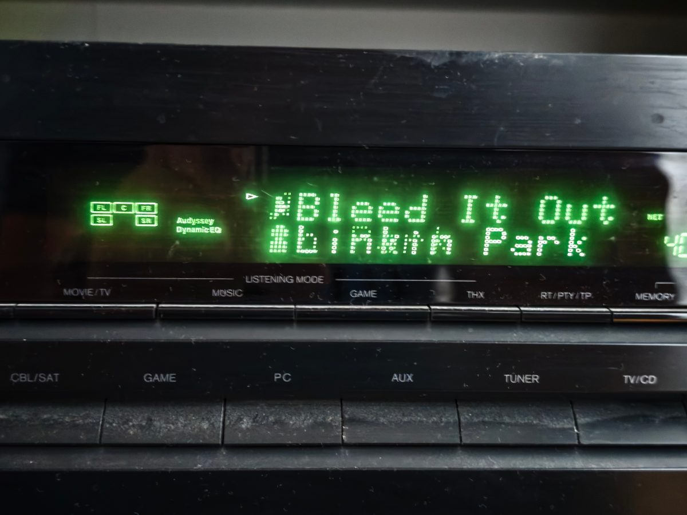
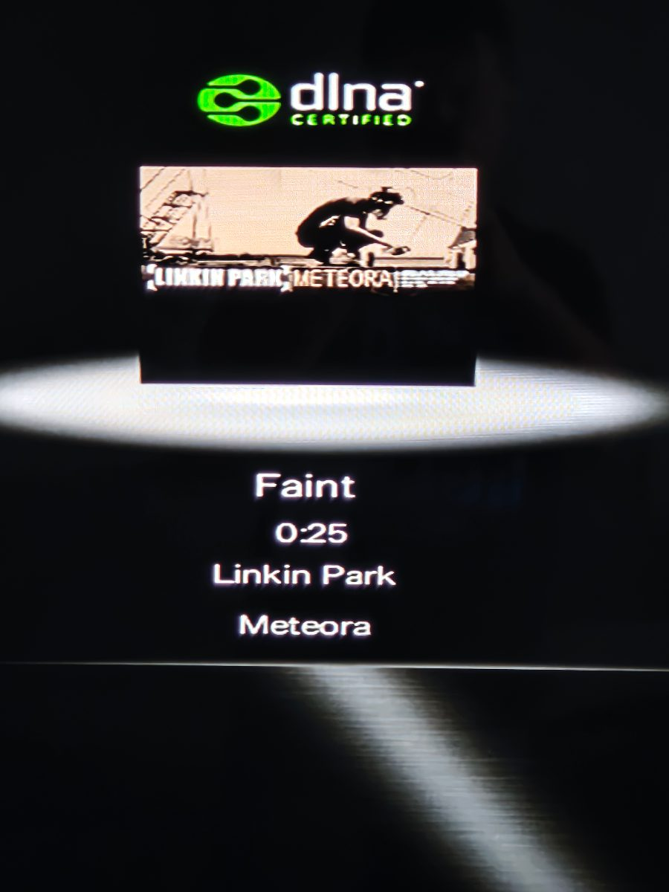

# onkyo-dlna-bridge

[English](README.md) | Polski

[](https://github.com/lisek84/onkyo-dlna-bridge/actions/workflows/image.yml)

Spotify dla sprzętu audio, który nie ma własnego, działającego Spotify. Mały kontener uruchamia Spotify
Soloist (oficjalnego klienta Spotify bez interfejsu) i przesyła to, co gra, do odtwarzacza DLNA/UPnP.
Urządzenie pojawia się w aplikacji Spotify jak każdy inny głośnik.

Napisałem to dla swojego Onkyo TX-NR609, któremu wbudowane Spotify umarło razem z libspotify, i tam działa
najpełniej: amplituner sam się włącza, przełącza wejście, pokazuje utwór na wyświetlaczu i okładkę na
telewizorze, a do tego reaguje na kilka przycisków pilota. Inne odtwarzacze DLNA (amplitunery, odtwarzacze
sieciowe, telewizory, Kodi) powinny dostać muzykę i zwykle informacje o utworze, tylko bez dodatków dla
Onkyo. Szczegóły w [docs/compatibility.md](docs/compatibility.md) (po angielsku).

Projekt nie jest powiązany ze Spotify ani z Onkyo i nie jest przez nie wspierany. Amplituner nie staje się
certyfikowanym urządzeniem Spotify Connect. Tylko do prywatnego, niekomercyjnego użytku.

<p align="center">
  
  
</p>
<p align="center"><sub>Wyświetlacz z bieżącym utworem i ekran amplitunera na telewizorze (przez HDMI).</sub></p>

## Skąd ten projekt

TX-NR609 to zupełnie dobry amplituner. Miał Spotify w menu NET, dopóki Spotify nie wyłączyło libspotify,
a Onkyo nigdy nie wydało niczego w zamian. Pozycja w menu dalej jest, tylko nie działa. Nie chciałem
wymieniać sprawnego wzmacniacza z takiego powodu.

Nie chciałem też grzebać w amplitunerze ani używać nieoficjalnego klienta Spotify, więc projekt korzysta
tylko z oficjalnych elementów:

- Spotify Soloist z Twoim własnym kluczem deweloperskim. Nie jest tu dołączony; każda instalacja pobiera go
  z CDN Spotify.
- Amplituner jest sterowany tylko przez to, co i tak udostępnia w sieci: odtwarzacz DLNA i protokół Onkyo
  eISCP (ten sam, którego używa aplikacja Onkyo Remote). Firmware nie jest ruszany.
- Strumień audio trafia tylko do Twojego amplitunera (innym domyślnie jest odmawiany) i nic nie jest
  nagrywane.

Jeśli masz stary amplituner, który tak samo stracił usługi streamingowe, może Ci się przyda.

## Jak to działa

```
 Spotify app ──Spotify Connect──►  Soloist ─► PulseAudio ─► swyh-rs ─► HTTP proxy ──DLNA/HTTP──► receiver
 (phone/PC)                        └──────────────── container (host network) ──────┘    ▲
                                    receiver control: UPnP AVTransport + eISCP (TCP 60128) ┘
```

Soloist gra do wirtualnego wyjścia PulseAudio, swyh-rs robi z tego zwykły strumień LPCM (44,1 kHz/16 bit)
po HTTP, a małe proxy podaje go amplitunerowi tak, żeby jego stary odtwarzacz DLNA go przyjął. Skrypt
nadzorujący śledzi stan Soloist i steruje amplitunerem: uruchamia odtwarzanie, przy każdym utworze wysyła
tytuł, wykonawcę, album i okładkę, pauzuje po naciśnięciu Stop i tak dalej.

Więcej w [docs/how-it-works.md](docs/how-it-works.md). Jeśli chcesz to rozwijać, wszystko, czego
dowiedziałem się o samym amplitunerze (układy, komunikaty eISCP, dziwactwa DLNA, które przyciski pilota
widać w sieci), jest w [docs/receiver-internals.md](docs/receiver-internals.md) (po angielsku).

## Co działa

Z każdym odtwarzaczem DLNA: urządzenie widać w aplikacji Spotify, gra w LPCM i dostaje tytuł, wykonawcę,
album i okładkę przy każdym utworze (przy podcastach nazwę podcastu). Soloist aktualizuje się sam, co ma
znaczenie, bo jego buildy wygasają po 90 dniach.

Na amplitunerach Onkyo/Integra dodatkowo:

- włącza amplituner i przełącza go na NET/DLNA, gdy zaczynasz odtwarzanie;
- Stop na pilocie pauzuje Spotify, NET wznawia, wyłączenie amplitunera pauzuje;
- opcjonalnie: NET jako „następny utwór” w trakcie grania, oddanie odtwarzania telefonowi po wyłączeniu
  amplitunera, suwak Spotify sterujący głośnością amplitunera, głośność startowa, powrót do poprzedniego
  wejścia (np. TV) i automatyczny standby.

Play, Pause, Next i Previous na pilocie nie dadzą się użyć. W trybie DLNA amplituner obsługuje te
przyciski wewnętrznie i nie zgłasza ich w sieci (sprawdzone przez eISCP i UPnP).

Na razie przetestowane: Onkyo TX-NR609 z Synology DS718+ (x86_64, DSM 7.2, Container Manager). Inne hosty
x86_64 z Linuksem i Dockerem albo Podmanem używają tego samego obrazu i powinny działać. Wersja na ARM
(`Dockerfile.arm`, Raspberry Pi) i Windows/WSL2 ([docs/windows.md](docs/windows.md)) nie były testowane.
Jeśli spróbujesz na innym sprzęcie, załóż [zgłoszenie](https://github.com/lisek84/onkyo-dlna-bridge/issues),
niezależnie od wyniku.

## Czego potrzeba

- Klucza API Spotify Soloist (niżej opisane, jak go zdobyć).
- Hosta z Linuksem (NAS, Raspberry Pi, cokolwiek) w tej samej sieci LAN, z Dockerem albo Podmanem i siecią
  hosta (`network_mode: host`). Wystarczy ok. 100 MB RAM; działa na x86_64, arm64 i armv7.
- Amplitunera w sieci, ze stałym adresem IP i dwoma sprawdzonymi ustawieniami (niżej).
- Amplituner musi móc połączyć się z hostem na porcie TCP 5901 (`STREAM_PORT`), a mDNS (UDP 5353) musi
  docierać do hosta (niżej, w części o sieci).

### Klucz API Spotify Soloist

Klucz jest darmowy, ale konto, które go tworzy, musi mieć Premium. Potem odtwarzać na urządzeniu mogą też
konta Free. Nie trzeba zakładać żadnej „aplikacji” ani Client ID/Secret.

1. Zaloguj się na <https://developer.spotify.com/> (przy pierwszej wizycie trzeba zaakceptować warunki).
2. Wejdź na stronę klucza Soloist: <https://developer.spotify.com/dashboard/soloist>.
3. Zaakceptuj warunki, jeśli się pojawią, i wygeneruj klucz.
4. Wpisz go do `soloist.env` jako `SOLOIST_API_KEY=...`.

Klucz jest prywatny, nie wklejaj go do zgłoszeń ani logów (`soloist.env` jest w `.gitignore`). Przy
pierwszym wybraniu urządzenia Soloist loguje się na konto, które je wybrało; logowanie zostaje zapisane
w `config/soloist-data/` i przetrwa restarty oraz przebudowy. Więcej:
[docs/spotify-developer-key.md](docs/spotify-developer-key.md).

### Przygotowanie amplitunera

1. Podłącz amplituner do sieci (najlepiej kablem), sprawdź, że działa NET (np. radio), i daj mu stały adres
   IP, najprościej rezerwacją DHCP w routerze. Ten adres to `RENDERER_IP`.
2. Włącz Network Standby (Setup → Hardware/Network Setup, zależnie od modelu). Bez tego w trybie czuwania
   amplituner znika z sieci i nie da się go włączyć zdalnie.
3. Otwórz w przeglądarce `http://<ip-amplitunera>/`, sekcja Unit information:
   - DMR Max Volume ustaw np. na 60–70. Przy `0` głośność spada do zera przy każdym utworze i to najczęstsza
     przyczyna „gra, ale nic nie słychać”;
   - Auto Play ustaw na Yes;
   - zapisz przyciskiem SAVE.

Jeśli odtwarzacz DLNA amplitunera kiedyś całkiem się zawiesi (port 8888 nie odpowiada), pomaga tylko
odłączenie zasilania na ok. 30 s. Standby nie restartuje części sieciowej. Więcej:
[docs/receiver-setup.md](docs/receiver-setup.md).

### Sieć i zapora

Kontener musi działać w sieci hosta, inaczej Spotify go nie znajdzie (mDNS), a amplituner nie połączy się
z hostem.

Najczęstszy problem: zapora na hoście po cichu blokuje amplitunerowi port TCP 5901. Amplituner odpowiada
wtedy na każde Play błędem UPnP 705 („Transport is locked”, czyli u niego „nie mogę otworzyć strumienia”)
i nic nie gra, a w logu brakuje linii `[proxy] <ip-amplitunera> GET /stream.lpcm`. Test z własnego komputera
niczego tu nie dowodzi, bo reguła musi wpuszczać adres amplitunera.

| Kierunek | Port | Po co |
|---|---|---|
| amplituner → host | TCP 5901 (`STREAM_PORT`) | pobieranie strumienia, trzeba otworzyć w zaporze |
| telefon/PC → host | UDP 5353 (mDNS) i dynamiczny port TCP Soloist | Spotify znajduje urządzenie i łączy się z nim |
| host → amplituner | TCP 8888, UDP 1900 (UPnP/SSDP), TCP 60128 (eISCP) | sterowanie, włączanie, wejście |
| host → internet | HTTPS | streaming i pobieranie Soloist |

Synology DSM z włączoną zaporą: Panel sterowania → Zabezpieczenia → Zapora → Edytuj reguły → Utwórz. Porty
niestandardowe TCP 5901, źródłowy adres IP amplitunera (albo cała podsieć LAN), działanie Zezwól; regułę
przesuń nad reguły „Odmów”. Wpuść też mDNS (UDP 5353) z LAN.

ufw (Ubuntu, Raspberry Pi OS):
```bash
sudo ufw allow from 192.168.1.50 to any port 5901 proto tcp     # IP amplitunera
sudo ufw allow from 192.168.1.0/24 to any port 5353 proto udp   # mDNS z LAN
```
firewalld i więcej szczegółów: [docs/networking.md](docs/networking.md).

## Instalacja

```bash
git clone https://github.com/lisek84/onkyo-dlna-bridge.git
cd onkyo-dlna-bridge
cp soloist.env.example soloist.env
nano soloist.env               # SOLOIST_API_KEY, RENDERER_IP, DEVICE_NAME, PUID/PGID
docker compose up -d --build   # Raspberry Pi: najpierw ustaw w compose.yaml dockerfile: Dockerfile.arm
docker compose logs -f
```

Potem otwórz Spotify na telefonie, wybierz `DEVICE_NAME` z listy urządzeń i włącz muzykę. Za pierwszym
razem Soloist zaloguje się na konto, które go wybrało; później łączy się sam.

Jest też gotowy obraz (amd64, arm64) w `ghcr.io/lisek84/onkyo-dlna-bridge`. Żeby go użyć, zamień blok
`build:` w `compose.yaml` na `image: ghcr.io/lisek84/onkyo-dlna-bridge:latest`.

### Synology DSM (Container Manager)

1. Zainstaluj Container Manager z Centrum pakietów.
2. Utwórz folder `/volume1/docker/onkyo-dlna-bridge` i skopiuj do niego `deploy/synology/compose.yaml` (jako
   `compose.yaml`), cały folder `image/` oraz `soloist.env.example` (jako `soloist.env`).
3. Uzupełnij `soloist.env`: klucz API, `RENDERER_IP`, `DEVICE_NAME`, `PUID`/`PGID` (zwykle `1026`/`100`,
   sprawdzisz przez SSH poleceniem `id`) i `HOST_IP`, czyli adres NAS w LAN.
4. Jeśli zapora DSM jest włączona, dodaj regułę dla TCP 5901 z adresu amplitunera (wyżej).
5. Container Manager → Projekt → Utwórz, wskaż folder z punktu 2 i wybierz istniejący `compose.yaml`. Obraz
   buduje się kilka minut, potem kontener startuje.
6. Log jest w Container Manager → Kontener → Log oraz w pliku `config/container.log`.

Pełna instrukcja: [docs/synology.md](docs/synology.md). Linux, Raspberry Pi, Podman/Quadlet:
[docs/linux.md](docs/linux.md). Windows (WSL2): [docs/windows.md](docs/windows.md).

## Ustawienia

Wszystko ustawia się w `soloist.env`; w [soloist.env.example](soloist.env.example) każda opcja ma komentarz.

| Zmienna | Domyślnie | |
|---|---|---|
| `SOLOIST_API_KEY` | (wymagane) | Twój klucz API Soloist |
| `RENDERER_IP` | (wymagane) | Adres IP amplitunera |
| `DEVICE_NAME` | `Onkyo Receiver` | Nazwa w aplikacji Spotify |
| `HOST_IP` | auto | Adres hosta w LAN; ustaw, jeśli host ma kilka sieci |
| `PUID` / `PGID` | `1000` / `1000` | Właściciel `./config` (Synology: zwykle `1026` / `100`) |
| `STREAM_PORT` | `5901` | Port, z którego amplituner pobiera dźwięk; musi być otwarty w zaporze |
| `STREAM_ALLOW` | `renderer` | Kto może pobrać strumień: `renderer` (tylko `RENDERER_IP`), lista adresów/podsieci albo pusto (każdy) |
| `SWYH_PORT` | `5911` | Wewnętrzny port przechwytywania, tylko localhost |
| `INITIAL_VOLUME` | `70` | Początkowa głośność Spotify |
| `META_UPDATE` | `yes` | Tytuł/wykonawca przy każdym utworze (2–4 s przerwy na początku utworu); `no` = bez przerw, stały `PLAY_TITLE` |
| `PLAY_TITLE` | `Spotify` | Tekst na wyświetlaczu, gdy metadane nie są wysyłane |
| `COVER_ART` | `yes` | Wysyłaj okładkę albumu |
| `COVER_SIZE` | `default` | `default` (300 px), `large` (640 px) albo `small` (64 px) |
| `ONKYO_EISCP` | `yes` | Używaj protokołu Onkyo eISCP; `no` dla innych odtwarzaczy |
| `AUTO_POWER_ON` | `yes` | Włączaj amplituner, gdy zaczyna się odtwarzanie |
| `REMOTE_CONTROL` | `yes` | Stop pauzuje, NET wznawia, wyłączenie pauzuje |
| `NET_RESUME_SECONDS` | `120` | Jak długo po Stop przycisk NET wznawia (NET otwiera też menu NET) |
| `NET_NEXT` | `no` | `yes`: NET w trakcie grania przełącza na następny utwór (do menu NET najpierw Stop) |
| `POWER_OFF_ACTION` | `pause` | Po wyłączeniu amplitunera: `pause` albo `release`, czyli pauza i rozłączenie, żeby przejął telefon |
| `VOLUME_SYNC` | `no` | Suwak głośności w Spotify i głośność amplitunera podążają za sobą |
| `VOLUME_MAX` | `50` | Głośność amplitunera odpowiadająca 100 % w Spotify (twardy limit) |
| `POWER_ON_VOLUME` | puste | Głośność ustawiana, gdy kontener włącza amplituner; puste = amplituner zostaje przy swojej zwykłej głośności |
| `RESTORE_INPUT` | `no` | Powrót do poprzedniego wejścia (np. TV), gdy Spotify skończy |
| `AUTO_POWER_OFF_MINUTES` | `0` | Standby po N minutach bez Spotify, jeśli to kontener włączył amplituner |
| `IDLE_STOP_SECONDS` | `300` | Zatrzymaj strumień po tylu sekundach pauzy |
| `LOG_TO_FILE` | `yes` | Zapisuj log także do `config/container.log` |

Obie opcje głośności są od siebie niezależne. Bez żadnej z nich głośność amplitunera zostaje w spokoju,
a suwak w Spotify zmienia tylko poziom strumienia. `POWER_ON_VOLUME` działa tylko wtedy, gdy kontener sam
włącza amplituner ze standby, a włączonego już amplitunera nigdy nie zmienia; zostaw puste, a amplituner
włączy się z głośnością, którą miał ostatnio. Przy `VOLUME_SYNC=yes` suwak w Spotify najpierw ustawia się
według aktualnej głośności amplitunera (sam amplituner się nie zmienia), a potem obie wartości podążają za
sobą.

## Na co dzień

Wybierasz urządzenie w Spotify i włączasz muzykę; po 8–15 sekundach amplituner jest włączony, na NET i gra.
Utwory przełączasz w aplikacji Spotify jak zwykle, a wyświetlacz nadąża. Stop na pilocie pauzuje Spotify,
NET w ciągu dwóch minut po tym wznawia. Wyłączenie amplitunera pauzuje Spotify i kontener nie włączy go
z powrotem. Przyciski głośności na pilocie sterują wzmacniaczem, suwak w Spotify strumieniem albo
wzmacniaczem przy `VOLUME_SYNC=yes`.

## Typowe problemy

| Objaw | Przyczyna / co zrobić |
|---|---|
| Urządzenia nie ma w Spotify | Brak `network_mode: host`; telefon w innej sieci, VLAN-ie albo sieci gości; zablokowany mDNS (UDP 5353) |
| Aplikacja „gra”, amplituner nic, w logu `Play … 705` i brak linii `[proxy] <ip-amplitunera> GET` | Zapora blokuje amplitunerowi TCP 5901 albo zły `HOST_IP` |
| Linie `[proxy] … GET` są, a dalej 705 | Odłącz amplituner od zasilania na ok. 30 s |
| Gra, ale nic nie słychać | DMR Max Volume = 0 na stronie amplitunera albo bardzo niska głośność w Spotify |
| Tytuł na wyświetlaczu odjeżdża i znika na ok. 2 minuty | Ograniczenie firmware w trybie DLNA (oficjalna aplikacja Onkyo ma to samo): tekst jest dopełniany do 64 znaków i przewijany razem z pustym miejscem. Telewizor pokazuje wszystko dobrze |
| Krótkie przerwy na początku każdego utworu | Normalne przy `META_UPDATE=yes`; ustaw `no`, jeśli wolisz bez przerw |
| Po ok. 3 miesiącach przestało działać | Build Soloist wygasł; kontener pobiera nowy po restarcie (`restart: unless-stopped` i dostęp do internetu) |

Więcej: [docs/troubleshooting.md](docs/troubleshooting.md).

## Dokumentacja (po angielsku)

- [Zgodność z innymi amplitunerami i odtwarzaczami](docs/compatibility.md)
- [Jak to działa](docs/how-it-works.md)
- [Szczegóły techniczne amplitunera (dla deweloperów)](docs/receiver-internals.md)
- [Dlaczego Soloist, a nie librespot/spotifyd](docs/why-soloist.md)
- [Klucz API Soloist](docs/spotify-developer-key.md)
- [Przygotowanie amplitunera](docs/receiver-setup.md)
- [Sieć i zapora](docs/networking.md)
- [Rozwiązywanie problemów](docs/troubleshooting.md)

## Kwestie prawne

Projekt nie jest powiązany ze Spotify ani z Onkyo i nie jest przez nie wspierany, sponsorowany ani
certyfikowany. „Spotify”, „Spotify Connect”, „Spotify Soloist” i „Onkyo” to znaki towarowe ich właścicieli,
użyte tylko do opisania zgodności; nie są używane żadne logo ani elementy marki.

Tylko do prywatnego, niekomercyjnego użytku, zgodnie z warunkami Spotify dla deweloperów. Dźwięk jest
przesyłany na żywo do Twojego amplitunera (domyślnie `STREAM_ALLOW=renderer`) i nigdy nie jest nagrywany ani
zapisywany.

Spotify Soloist nie jest rozpowszechniany razem z projektem. Kontener pobiera go z CDN Spotify przy
uruchomieniu, a jego używanie podlega warunkom akceptowanym przy tworzeniu klucza API (zob.
[dokumentację Soloist](https://developer.spotify.com/documentation/soloist)). Klucz jest osobisty, nie
udostępniaj go.

Obraz kontenera zawiera skrypty tego projektu, pakiety Debiana i program
[swyh-rs](https://github.com/dheijl/swyh-rs) (MIT © dheijl, licencja w obrazie pod
`/usr/share/doc/swyh-rs/LICENSE`). Nie zawiera Soloist.

Kod jest na licencji MIT, © Lisek ([lisek84](https://github.com/lisek84)). Zob. [LICENSE](LICENSE).
